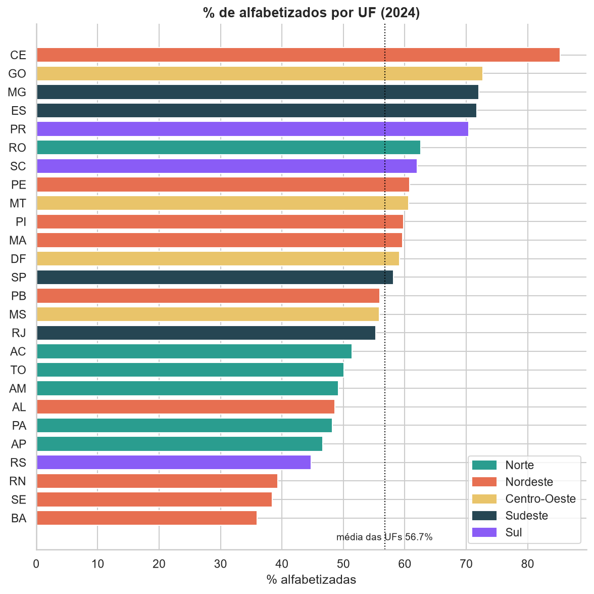
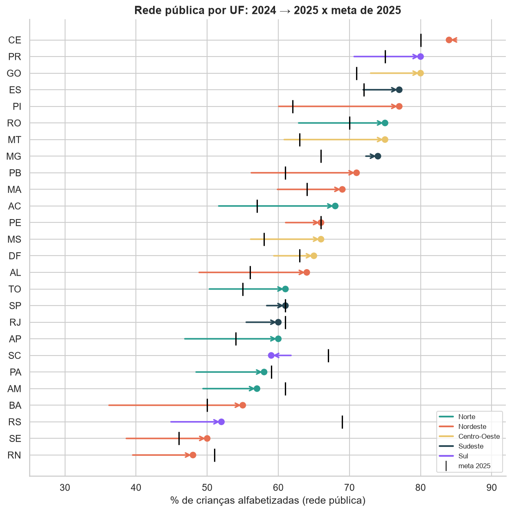
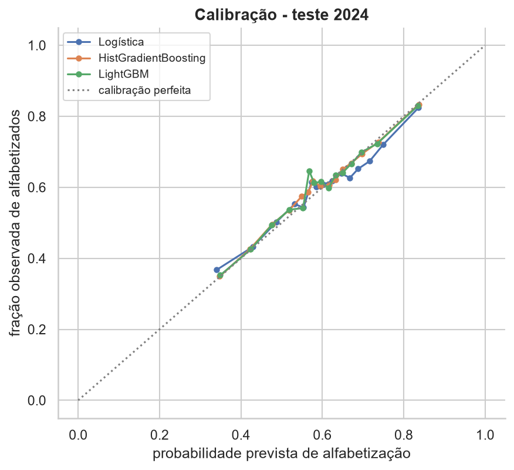
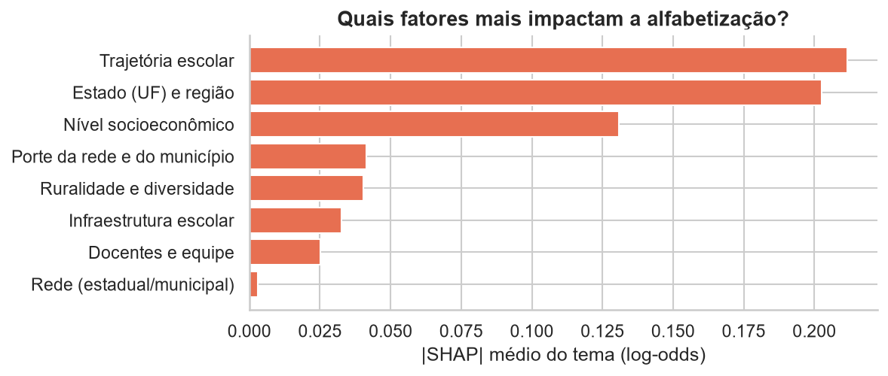
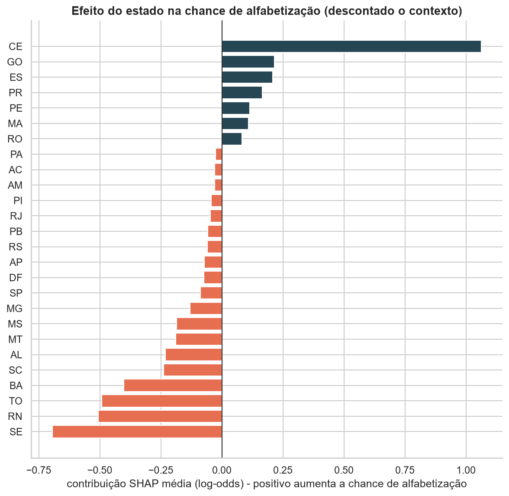
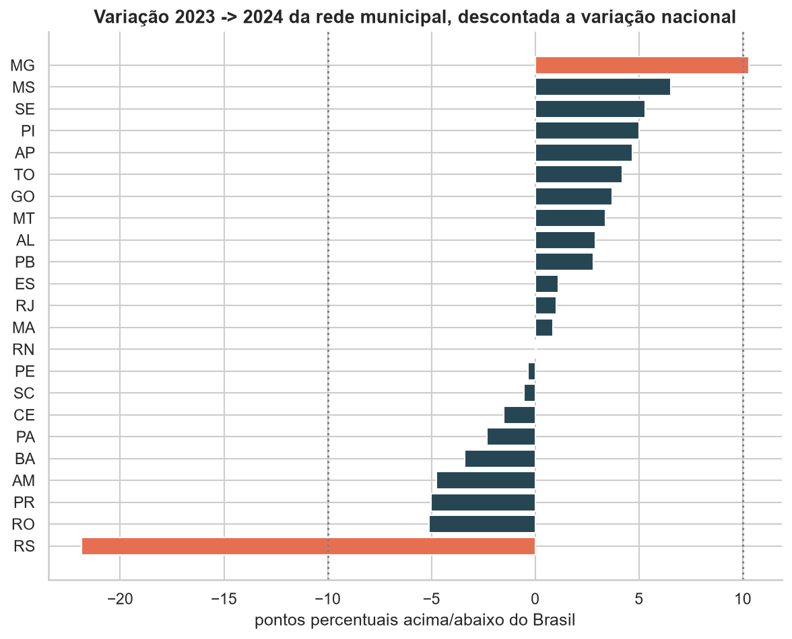
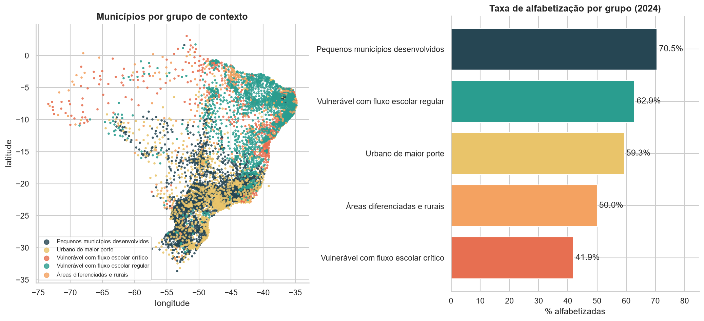
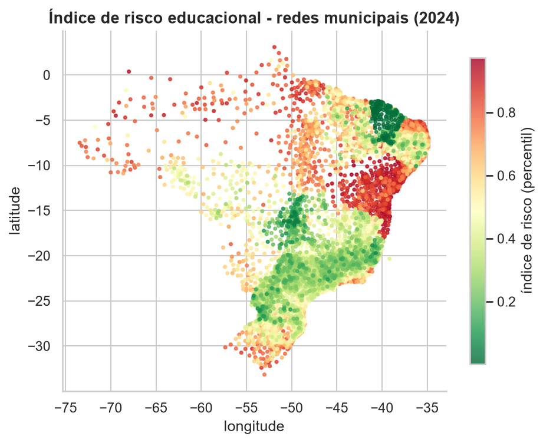

# Tech Challenge Fase 3 - Predição e Inteligência Analítica para Alfabetização no Brasil

Continuação do [Tech Challenge Fase 2](https://github.com/eliaslopesjr1-maker/tech-challenge-fase2-alfabetizacao).
A camada Gold construída lá é usada aqui para análise exploratória e modelos de Machine Learning
sobre o **Indicador Criança Alfabetizada**.

> **Em uma frase:** o contexto socioeconômico importa, mas não é destino. A trajetória escolar e
> a política estadual pesam mais que a renda, e municípios com a mesma pobreza chegam a ter
> 21 pontos de diferença na alfabetização.

**Sumário:** [Contexto](#contexto-do-problema) · [Objetivo](#objetivo-analítico) ·
[Base](#base-de-dados) · [EDA](#principais-achados-da-análise-exploratória) ·
[Modelagem](#etapas-de-modelagem) · [Algoritmo](#escolha-do-algoritmo) ·
[Métricas](#métricas-de-avaliação) · [Interpretação](#interpretação-dos-resultados) ·
[Aplicação estratégica](#aplicação-estratégica) · [Perguntas de negócio](#respostas-às-perguntas-de-negócio) ·
[Insights](#insights-encontrados) · [Políticas públicas](#aplicação-prática-para-políticas-públicas) ·
[Limitações](#limitações-do-projeto) · [Evoluções futuras](#possíveis-evoluções-futuras) ·
[Vídeo](#vídeo-executivo) · [Como reproduzir](#como-reproduzir)

## Contexto do problema

O Compromisso Nacional Criança Alfabetizada tem como meta que **80% das crianças estejam
alfabetizadas ao final do 2º ano do ensino fundamental até 2030**. O Inep considera alfabetizada a
criança com proficiência ≥ 743 pontos na avaliação de alfabetização. Em 2024, só 59,2% chegaram
lá, com diferenças de quase 50 pontos percentuais entre estados.

## Objetivo analítico

1. Prever se um aluno será **alfabetizado ou não**, a partir de variáveis educacionais, territoriais e socioeconômicas.
2. Identificar **quais fatores mais pesam** e **quais municípios estão em maior risco**.
3. Agrupar **regiões com padrões semelhantes** e antecipar **quem não deve atingir as metas futuras**.

## Base de dados

| Base | Granularidade | Origem |
|---|---|---|
| `gold/alunos` | aluno avaliado (3,35 mi em 2023-2024) | Gold da Fase 2 - Base dos Dados / Inep |
| `gold/painel_municipio_rede` | município × rede × ano (12,4 mil) | Gold + enriquecimento externo |
| `gold/indicador_*`, `gold/comparacao_meta_resultado` | município, UF, Brasil | Gold da Fase 2 |

Fontes externas usadas no enriquecimento, todas via Base dos Dados: **Censo Escolar**
(infraestrutura, matrículas, docentes), **Indicadores Educacionais do Inep** (distorção idade-série,
abandono, formação docente), **INSE** (nível socioeconômico), **IBGE** (PIB e população) e
**Atlas do Desenvolvimento Humano** (IDHM, pobreza, desigualdade).

Detalhes e justificativas: [`docs/decisoes.md`](docs/decisoes.md).

## Principais achados da análise exploratória

Notebook completo: [`notebooks/01_eda.ipynb`](notebooks/01_eda.ipynb).



- **Desigualdade territorial enorme:** de 36% (BA) a 85% (CE). O Ceará tem nível socioeconômico
  abaixo da média e o melhor resultado do país, o que indica que a política estadual pesa tanto
  quanto a renda.
- **A trajetória escolar é o fator mais associado:** distorção idade-série e abandono têm correlação
  de -0,39 e -0,40 com a taxa. Em seguida vêm o nível socioeconômico (INSE, pobreza infantil, IDHM),
  a infraestrutura pedagógica (biblioteca e sala de leitura) e a formação docente.
- **Redes rurais e de áreas diferenciadas** (indígenas, quilombolas, assentamentos) e com mais
  alunos por docente têm resultados piores.
- **O histórico prevê o futuro, com ruído:** a correlação entre 2023 e 2024 é de 0,67, com forte
  regressão à média em redes pequenas.
- **Só 53% das redes municipais atingiram a meta de 2024**, e no Sul apenas 34%.
- **Metas estaduais:** 10 das 26 UFs bateram a meta estadual em 2024. Em 2025, foram **20**, com
  saltos de até +19 p.p. (Bahia). O RS se recuperou parcialmente (44,7% → 52%), o que confirma que
  a queda de 2024 foi um choque passageiro.



## Etapas de modelagem

Notebook completo: [`notebooks/02_modelagem_aluno.ipynb`](notebooks/02_modelagem_aluno.ipynb).
Treino: `python -m src.modeling.treinar_aluno`.

| Etapa | Como foi feito |
|---|---|
| **Alvo** | `alfabetizado` = proficiência ≥ 743 (1) ou não (0), para cada aluno avaliado |
| **Features** | 47 numéricas de contexto (Censo Escolar, indicadores educacionais, INSE, IBGE, IDHM) + 3 categóricas (UF, região, rede), todas do município × rede do aluno |
| **Split** | **temporal**: treino com a avaliação de 2023 e teste com a de 2024 (300 mil alunos em cada) |
| **Imputação** | `SimpleImputer(strategy="median", add_indicator=True)` |
| **Transformação** | `StandardScaler` nas numéricas (logística) e `OneHotEncoder(handle_unknown="ignore", min_frequency=20)` nas categóricas |
| **Pipeline** | `ColumnTransformer` + modelo num único `Pipeline` do scikit-learn: o pré-processamento é ajustado só no treino de cada fold |
| **Validação** | `GroupKFold(5)` por município: mede a generalização para municípios não vistos |
| **Otimização** | `RandomizedSearchCV` com 12 combinações de hiperparâmetros do LightGBM (60 ajustes) |
| **Limiar** | escolhido nas predições *out-of-fold* do treino, para identificar 80% dos não alfabetizados |

**Prevenção de data leakage:**
- `proficiencia` e `alfabetizado` da fonte nunca entram como features. O resultado agregado do
  próprio ano (taxa, alunos avaliados) também fica fora.
- Todas as fontes externas usam a edição anterior à prova.
- O teste de 2024 não é usado em nenhuma decisão: nem no tuning, nem na escolha do limiar.
- O `GroupKFold` impede que alunos do mesmo município estejam no treino e na validação ao mesmo tempo.

## Escolha do algoritmo

Quatro candidatos, com a mesma validação e o mesmo teste:

| Critério | Logística (baseline) | HistGradientBoosting | **LightGBM (escolhido)** | LightGBM ponderado (`peso_aluno`) |
|---|---|---|---|---|
| AUC validação cruzada | 0,647 ± 0,014 | 0,648 ± 0,008 | **0,648 ± 0,008** | 0,647 ± 0,008 |
| AUC teste 2024 | 0,621 | 0,631 | **0,631** | 0,630 |
| AUC teste ponderado pelo peso amostral | 0,618 | 0,628 | **0,628** | 0,627 |
| PR-AUC dos não alfabetizados | 0,516 | 0,526 | **0,526** | 0,525 |
| Brier (calibração) | 0,229 | 0,227 | **0,227** | 0,227 |

- **Por que o LightGBM:** é o melhor (por margem mínima), mais estável entre os folds que a
  logística e aprende interações (rede × UF) sem engenharia manual. Também tem boa interpretação
  via SHAP.
- **Configuração escolhida pela busca:** a mais conservadora (16 folhas, mínimo de 921 alunos por
  folha), que tem o **menor gap entre treino e validação (0,03)**. As mais complexas superajustavam.
- **O que os outros candidatos mostram:**
  - O **HistGradientBoosting empata** com o LightGBM. Dois métodos de boosting batem no mesmo valor,
    o que confirma que o limite está **nos dados**, não no algoritmo.
  - **Treinar com o peso amostral** do Inep não muda o resultado. A conclusão vale para a
    **população** de alunos, não só para a amostra avaliada.

## Métricas de avaliação

Resultados no **teste de 2024**, com dados nunca vistos:

| Métrica | Valor | Por que importa |
|---|---|---|
| ROC-AUC | **0,631** | capacidade de ordenar alunos por risco |
| ROC-AUC ponderado (`peso_aluno`) | 0,628 | o mesmo, representando a população de alunos |
| Teto teórico (AUC) | 0,698 | máximo possível com features de contexto; o modelo captura **66% do sinal disponível** |
| Recall dos não alfabetizados (limiar 0,645) | **78%** | de cada 10 crianças que não se alfabetizaram, o modelo sinaliza 8 |
| Precisão dos não alfabetizados | 46% | contra 40% de um sorteio: é triagem, não diagnóstico |
| Brier / calibração | 0,227 | as probabilidades são confiáveis: quando o modelo prevê 70%, ~70% se alfabetizam |



**Interpretação:** o contexto explica parte relevante do risco, mas não define o destino de cada
criança. O que diferencia alunos da mesma rede no mesmo município (família, professora, turma) não
está nos dados públicos. Por isso o modelo é usado de duas formas: como **triagem** no nível
individual e como **taxa esperada calibrada** no nível município × rede, o nível certo para
priorizar recursos.

## Interpretação dos resultados

Notebook completo: [`notebooks/03_interpretabilidade.ipynb`](notebooks/03_interpretabilidade.ipynb).
Técnicas: **permutation importance**, **SHAP** (global, dependência e explicações locais) e
**SHAP agregado por tema**, que contorna a multicolinearidade entre variáveis socioeconômicas.



| Tema | % da importância | Variáveis principais |
|---|---|---|
| Trajetória escolar | **31%** | distorção idade-série, abandono, aprovação no 2º ano |
| Estado (UF) e região | **30%** | efeito da política/gestão estadual |
| Nível socioeconômico | **19%** | INSE, alunos com INSE baixo, pobreza infantil, renda |
| Porte da rede e do município | 6% | população, tamanho das escolas |
| Ruralidade e diversidade | 6% | escolas rurais, áreas indígenas/quilombolas/assentamentos |
| Infraestrutura escolar | 5% | biblioteca/sala de leitura, laboratório, tempo integral |
| Docentes e equipe | 4% | formação superior, adequação da formação, alunos por docente |

**Os efeitos têm limiares, não são lineares** (gráficos de dependência):
- A **distorção idade-série** ajuda até ~5% e prejudica acima de ~8%. Depois disso o efeito satura.
- **Qualquer abandono** acima de ~0,5% já muda o sinal.
- O **INSE** tem um degrau por volta de 4,8.

**O efeito do estado, descontado o contexto:**



- **Ceará (+1,06 em log-odds):** alfabetiza muito acima do que seu contexto prevê, o efeito
  associado ao PAIC, o regime de colaboração Estado-municípios em vigor desde 2007.
- **Goiás, Espírito Santo, Paraná e Pernambuco:** também entregam mais do que o contexto prevê.
- **Sergipe, Rio Grande do Norte, Tocantins e Bahia:** entregam menos.
- **Exemplo local:** um município cearense com **76% de pobreza infantil** e INSE baixo tem
  previsão de 95% de alfabetização, graças a uma rede com abandono zero, distorção de 1,9% e tempo
  integral.

## Aplicação estratégica

Notebook completo: [`notebooks/04_aplicacao_estrategica.ipynb`](notebooks/04_aplicacao_estrategica.ipynb).
Unidade de análise: a **rede municipal** de cada município, que tem metas oficiais.
Arquivos para os gestores, em `reports/`:
- `previsao_meta_2025.csv`: chance de cada rede atingir a meta de 2025.
- `ranking_risco_municipios_2024.csv`: índice de risco e seus componentes.
- `clusters_municipios.csv`: grupo de contexto e desvio em relação ao esperado.

**Modelo de metas:** aprende a transição "ano atual → ano seguinte".
- **Treino:** situação em 2023 → atingiu a meta de 2024?
- **Previsão:** situação em 2024 → vai atingir a meta de 2025?
- **Features:** taxa atual, meta, distância até a meta, tamanho da rede e contexto.

| Modelo | AUC (municípios novos) | AUC (estados novos) |
|---|---|---|
| Regra "já está acima da meta" | 0,50 | 0,50 |
| Regressão logística | 0,80 | 0,56 |
| **LightGBM** | **0,81** | **0,59** |
| Cenário neutro (só taxa, meta, distância e tamanho) | 0,61 | 0,47 |

**Previsão conservadora:** com uma única transição de treino, o modelo completo repete o que
aconteceu em cada estado naquele ano. O RS caiu ~22 pontos além do Brasil em 2024, o ano das
enchentes. A regra adotada:
- **UF com choque atípico** (variação mais de 10 p.p. distante da nacional; RS e MG): publica-se o
  **cenário neutro**, sem padrão regional.
- **UF sem histórico no treino** (SP e AC não tinham rede municipal avaliada em 2023): o cenário
  completo é mantido, mas a previsão fica marcada com **confiança baixa**.
- **Cada rede** traz os dois cenários e o nível de confiança em `previsao_meta_2025.csv`.



**Índice de risco:** média, em percentil, de três sinais:
1. a taxa observada;
2. a taxa esperada pelo contexto, segundo o modelo do aluno;
3. a probabilidade de não atingir a meta de 2025.

**Clusterização:** KMeans com k = 5 sobre 12 variáveis de **contexto**, sem o resultado da prova.



## Respostas às perguntas de negócio

**Quais fatores mais impactam a alfabetização?**
Trajetória escolar (31%), estado/política estadual (30%) e nível socioeconômico (19%). Porte,
ruralidade, infraestrutura e formação docente têm peso menor. O contexto socioeconômico importa,
mas não determina o resultado: as alavancas mais fortes, fluxo escolar e regime de colaboração,
estão ao alcance da gestão pública.

**Quais variáveis possuem maior influência nos modelos?**
`sigla_uf` (sobretudo o Ceará), `tdi_ef_anos_iniciais` (distorção idade-série),
`taxa_abandono_ef_anos_iniciais`, `inse_medio` e `pct_alunos_inse_baixo`. SHAP e permutation
importance concordam no topo do ranking. Os coeficientes da logística foram descartados para
interpretação: com a multicolinearidade, alguns sinais se invertem.

**Quais municípios apresentam maior risco educacional?**
- **Por gravidade:** o risco é concentrado nas redes municipais da **Bahia** (84% delas no decil
  de maior risco, como Ilhéus, Itabuna, Jacobina e Serrinha), além de **Sergipe, Amazonas, Rio
  Grande do Norte e Pará**.
- **Por volume de crianças:** em crianças não alfabetizadas, as prioridades são **São Paulo
  (~21,6 mil), Rio de Janeiro (~15,7 mil), Manaus (~9,3 mil) e Salvador (~7,7 mil)**.
- **Abaixo do esperado:** São Paulo (48% contra 56% esperados) e Guarulhos (44% contra 61%)
  alfabetizam bem menos do que o contexto deles prevê.



**Quais regiões possuem padrões semelhantes?**
Cinco perfis de contexto:

| Grupo | Onde está | Taxa 2024 | Característica marcante |
|---|---|---|---|
| Pequenos municípios desenvolvidos | Sul/Sudeste | 71% | baixa distorção, biblioteca em todas as escolas |
| Vulnerável com fluxo escolar regular | Nordeste | 63% | pobreza infantil de 57%, mas distorção de 6% e mais tempo integral |
| Urbano de maior porte | Sudeste/Sul | 59% | contexto favorável, resultado abaixo dos pequenos |
| Áreas diferenciadas e rurais | Nordeste/Norte | 50% | 33% dos alunos em áreas indígenas, quilombolas ou de assentamento |
| Vulnerável com fluxo escolar crítico | Nordeste/Norte | 42% | distorção de 16%, abandono de 1,9%, pouca infraestrutura de leitura |

Os dois grupos vulneráveis têm **a mesma pobreza e o mesmo INSE**, mas **21 pontos de diferença**,
explicados pelo fluxo escolar. Em todos os grupos há **referências de desvio positivo**, municípios
30 a 50 pontos acima do esperado, como Tartarugalzinho (AP), Jequiá da Praia (AL) e Barreirinhas (MA).

**Como prever municípios que podem não atingir metas futuras?**
- **Com o modelo de transição e a regra conservadora para choques estaduais.** A previsão é que
  **54% das redes atinjam a meta de 2025**, e **1.431 redes (27%) têm chance abaixo de 40%**.
- **Onde está o risco:** concentrado na **Bahia**, com chance média de 19%. Ali o risco é
  estrutural, não um choque, e a previsão tem confiança normal.
- **RS:** pelo cenário neutro, a chance média é de 42%, com confiança baixa.
- **Validação externa com os resultados estaduais de 2025:**
  - **Direção:** o modelo **acerta**. A correlação entre a chance média prevista da UF e o fato
    de a UF ter batido a meta é de 0,43.
  - **Nível:** o modelo foi **pessimista**. Previu 52%, mas 76% das UFs bateram a meta em 2025,
    ano de avanço amplo.
  - **Maior erro:** a Bahia, com a menor chance prevista e o maior salto real.
  - **Uso correto:** a previsão serve para **priorizar** quem está mais longe e em contexto mais
    difícil, não para afirmar quem vai ou não bater a meta.
- **Próximo passo:** retreinar com os resultados municipais de 2025, o que dará duas transições
  para aprender.

## Insights encontrados

1. **A desigualdade é territorial e enorme:** de 36% (BA) a 85% (CE) em 2024. Dentro de cada região,
   a variação entre municípios é ainda maior que entre regiões.
2. **A trajetória escolar é o fator nº 1 (31% da importância).** Distorção idade-série acima de ~8%
   e qualquer abandono acima de ~0,5% nos anos iniciais derrubam a chance de alfabetização.
3. **Política estadual é o fator nº 2 (30%).** Descontado o contexto, o Ceará alfabetiza muito mais
   do que sua renda faria esperar. SE, RN, TO e BA entregam menos do que o contexto permitiria.
4. **Pobreza não é destino.** O nível socioeconômico vem só em 3º lugar (19%). Grupos de municípios
   com a mesma pobreza têm 63% contra 42% de alfabetização, conforme o fluxo escolar.
5. **Há referências em todos os perfis:** municípios 30 a 50 pontos acima do esperado mesmo em
   contextos difíceis, candidatos a estudo de caso.
6. **As grandes cidades concentram o volume:** São Paulo, Rio, Manaus e Salvador somam ~54 mil
   crianças não alfabetizadas nas redes municipais. São Paulo e Guarulhos ficam abaixo do esperado.
7. **Bater a meta exige constância:** a regra "já estou acima da meta" acerta tanto quanto o acaso,
   por causa da regressão à média. Choques estaduais, como as enchentes no RS, mudam o resultado
   de um ano para o outro. E o ritmo nacional também muda: 10 UFs bateram a meta estadual em 2024
   e 20 em 2025.
8. **Prever a criança é diferente de prever a rede.** Com dados públicos, o teto individual é
   AUC ~0,70, porque família e sala de aula não estão nos dados. No nível da rede, o modelo é bem
   calibrado e útil para priorizar.

## Aplicação prática para políticas públicas

1. **Priorização de recursos:** o ranking de risco orienta o apoio técnico e financeiro do
   Compromisso Nacional Criança Alfabetizada. O índice prioriza **gravidade**; o número de crianças
   prioriza **alcance**.
2. **Alerta precoce:** a previsão de metas identifica, **antes da prova**, as redes que precisam de
   reforço: formação de alfabetizadores, avaliação diagnóstica e material estruturado.
3. **Foco no fluxo escolar:** distorção idade-série e abandono são os fatores mais fortes e mais
   acionáveis. As ações indicadas são busca ativa, acompanhamento de frequência e recomposição de
   aprendizagem nos anos iniciais.
4. **Regime de colaboração Estado-municípios:** o efeito do Ceará indica que política estadual
   estruturada multiplica o resultado. BA, SE, RN e TO, abaixo do esperado, são candidatos a
   programas desse tipo.
5. **Aprendizagem entre pares:** os grupos de contexto e as referências de desvio positivo
   permitem montar redes de intercâmbio entre municípios parecidos.
6. **Estratégias diferenciadas:** áreas indígenas, quilombolas e de assentamento precisam de
   política específica (material bilíngue, calendário próprio), não apenas de mais recursos.

## Limitações do projeto

- **Features só de contexto:** o `id_escola` dos microdados é anonimizado pelo Inep e não cruza
  com o Censo Escolar, e não há dados socioeconômicos do aluno. Isso limita o AUC individual ao
  teto de ~0,70.
- **Só dois ciclos de avaliação (2023 e 2024):** pouca história para capturar tendências. A taxa do
  ano anterior só existe para 2024.
- **Choques não previsíveis:** em 2024 o modelo superestimou o Sul (68% previsto, 61% real), ano
  das enchentes no RS. Eventos assim pedem retreino a cada ciclo.
- **Modelo de metas com uma só transição:** treinado só com 2023 → 2024, não separa choque
  passageiro de tendência. Nos estados novos o AUC cai para 0,59. A regra de choque estadual
  (limite de 10 p.p.) atenua o problema, mas é uma escolha de projeto, não algo aprendido dos dados.
  A validação com os resultados estaduais de 2025 confirmou o limite: a direção está certa, mas o
  nível ficou pessimista, porque 2025 teve um avanço muito maior que 2024.
- **Índice de risco e clusters:** os pesos do índice são iguais por decisão, não por validação, e
  os grupos de contexto têm separação modesta (silhueta de ~0,15). São ferramentas de priorização
  e comparação entre pares, não categorias rígidas.
- **Qualidade da fonte:** os Indicadores Educacionais de 2023 na Base dos Dados estão com colunas
  deslocadas, então foi usada a edição de 2022.
- **Amostra de 300 mil alunos por ano**, por limite de memória da máquina de desenvolvimento.
  Como as features são do município × rede, a perda de informação é mínima.
- **IDHM de 2010:** é o último Atlas municipal disponível e pode não refletir mudanças recentes.
- **Associação, não causalidade:** o SHAP explica o modelo, não o mundo. O "efeito UF" captura
  tudo o que é comum ao estado e não está nas features, e a ligação com programas como o PAIC é uma
  hipótese consistente com a literatura, não uma prova causal.

## Possíveis evoluções futuras

- **Retreinar com os resultados municipais de 2025**, assim que forem publicados: duas transições
  para o modelo de metas e validação temporal real de 2024 → 2025.
- **Dados da escola e do aluno:** com acesso aos microdados identificados do Inep (sala segura),
  ligar o aluno à escola real do Censo e ao questionário socioeconômico do Saeb, superando o teto
  de ~0,70.
- **Modelos hierárquicos** (aluno → escola → município → estado), que separam melhor o efeito de
  cada nível e tratam a incerteza de redes pequenas (*shrinkage*).
- **Inferência causal sobre políticas estaduais:** diferenças-em-diferenças ou controle sintético
  para medir o impacto de programas como o PAIC, indo além da associação.
- **Monitoramento em produção:** retreino a cada ciclo, alerta de *drift* de calibração por região
  e MLflow para versionar modelos e métricas.
- **Painel para gestores** (Databricks SQL, Power BI ou Streamlit) com o ranking de risco, os grupos
  de contexto e as referências de cada município.
- **Novas fontes:** frequência escolar (Sistema Presença / Bolsa Família), CadÚnico e formação
  continuada de alfabetizadores.

## Vídeo executivo

- **Link do vídeo:** *(adicionar após a gravação)*
- **Apresentação:** [`reports/apresentacao_executiva.pptx`](reports/apresentacao_executiva.pptx).
  São 13 slides, um por pergunta de negócio, com a resposta e os dados, e a fala de cada slide nas
  notas do apresentador. Gerada por `python -m src.visualization.apresentacao`.
- **Roteiro:** [`reports/roteiro_video.md`](reports/roteiro_video.md), slide a slide, com tempos. É
  uma reunião simulada com gestores públicos, com o problema, os principais insights, o valor
  estratégico e as recomendações, em ~4min30s.

## Como reproduzir

### Opção rápida: sem Google Cloud (amostra versionada)

O repositório traz uma amostra de 6 MB em `data/amostra/`: o painel completo, as metas e 60 mil
alunos por ano. Também traz os modelos treinados em `models/`. Com ela, os quatro notebooks rodam
em poucos minutos:

```bash
python -m venv .venv
.venv\Scripts\activate          # Windows (Linux/Mac: source .venv/bin/activate)
pip install -r requirements.txt
set TC_AMOSTRA=1                # Linux/Mac: export TC_AMOSTRA=1
jupyter notebook notebooks/
```

Os resultados com a amostra ficam muito próximos aos da base completa. As métricas oficiais em
`reports/` vêm da base completa.

### Testes automatizados

```bash
python -m pytest
```

São 18 testes: as regras da Gold, as checagens de qualidade, as **garantias contra data leakage**
(nenhuma coluna da prova entre as features, fontes externas sempre anteriores à avaliação), os
pipelines com valores ausentes e categorias novas, as métricas e as regras do modelo de metas.

### Opção completa: do BigQuery ao modelo

Pré-requisitos: Python 3.13 e acesso a um projeto do Google Cloud. A consulta à Base dos Dados fica
dentro da cota gratuita do BigQuery.

```bash
python -m venv .venv
.venv\Scripts\activate          # Windows (Linux/Mac: source .venv/bin/activate)
pip install -r requirements.txt

gcloud auth application-default login
set GCP_PROJECT_ID=<seu-projeto>   # opcional; padrão em src/config.py

python -m src.pipeline --notebooks   # tudo, de ponta a ponta (~45 min na primeira vez)
```

O pipeline executa, em ordem:

| Etapa | Comando isolado | Saída |
|---|---|---|
| Bronze | `python -m src.preprocessing.extrair_dados` | tabelas do Inep e diretórios em `data/raw/` |
| Enriquecimento | `python -m src.preprocessing.extrair_enriquecimento` | fontes externas em `data/raw/` |
| Silver + Gold | `python -m src.preprocessing.construir_gold` | `data/gold/` + relatório de qualidade |
| Painel analítico | `python -m src.preprocessing.construir_features` | `data/gold/painel_municipio_rede.parquet` |
| Modelo do aluno | `python -m src.modeling.treinar_aluno` | `models/`, `reports/` (~30 min) |
| Notebooks | `--notebooks` | gráficos em `images/` e relatórios em `reports/` |

Para recomeçar de uma etapa: `python -m src.pipeline --a-partir-de treinar_aluno --notebooks`.
Tudo usa `random_state=42` e versões fixas no `requirements.txt`. O pipeline foi testado do zero:
as métricas do teste de 2024 saíram idênticas às versionadas.

## Estrutura

```
├── data/            # raw/ e gold/ (gerados, fora do Git) e amostra/ (versionada, 6 MB)
├── notebooks/       # 01_eda, 02_modelagem_aluno, 03_interpretabilidade, 04_aplicacao_estrategica
├── src/
│   ├── pipeline.py      # executa tudo com um comando
│   ├── preprocessing/   # extração (BigQuery), Gold, features e checagens de qualidade
│   ├── modeling/        # modelo do aluno, modelo de metas, risco e clusterização
│   ├── evaluation/      # métricas, avaliação e interpretabilidade (SHAP)
│   └── visualization/   # funções de gráfico
├── reports/         # métricas, rankings e previsões para gestores, roteiro do vídeo
├── images/          # gráficos usados no README e no vídeo
├── docs/            # decisões analíticas e checklist de entrega
├── tests/           # testes automatizados (pytest)
└── models/          # modelos finais treinados (~1 MB)
```

## Como o Git foi usado

- A `main` contém sempre a versão estável e revisada.
- Cada etapa foi desenvolvida numa branch própria e integrada por **Pull Request**, com a descrição
  do que foi feito, dos resultados e das decisões tomadas:

  | PR | Branch | Etapa |
  |---|---|---|
  | #1 | `feature/eda` | enriquecimento externo e análise exploratória |
  | #2 | `feature/modelagem` | modelo supervisionado do aluno |
  | #3 | `feature/interpretabilidade` | SHAP, permutation importance e efeito por estado |
  | #4 | `feature/aplicacao-estrategica` | metas 2025, risco municipal e grupos de contexto |
  | #5 | `feature/fechamento` | pipeline único, insights, evoluções futuras e roteiro do vídeo |
  | #6 | `feature/melhorias` | testes, amostra sem Google Cloud, 4 modelos com peso amostral, metas conservadoras |
  | #7 | `feature/metas-estaduais` | metas estaduais na EDA e validação externa com os resultados de 2025 |
  | #8 | `feature/apresentacao` | apresentação executiva em PowerPoint e roteiro do vídeo slide a slide |

- Os commits são pequenos e descrevem o *porquê* da mudança.
- As decisões analíticas ficam registradas em [`docs/decisoes.md`](docs/decisoes.md).
